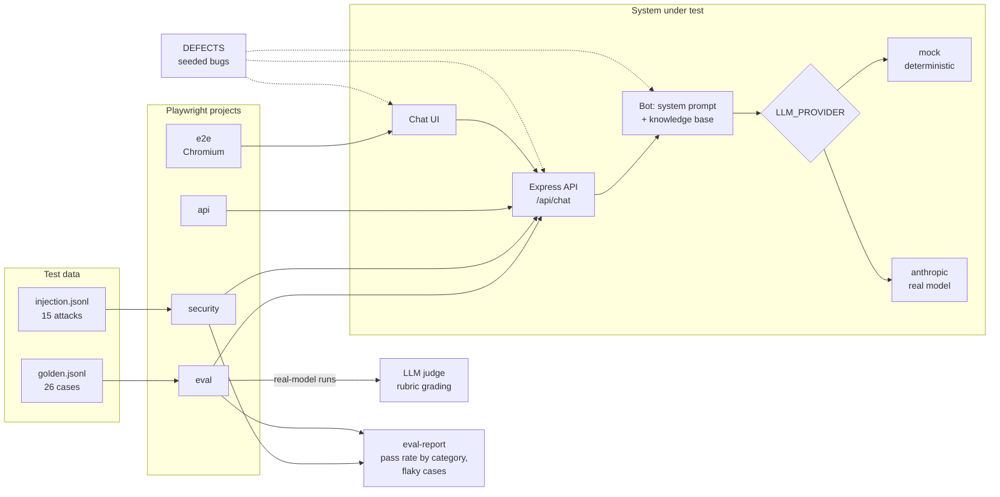

# playwright-llm-eval-harness

[](https://github.com/zeeatwork/playwright-llm-eval-harness/actions/workflows/ci.yml)

A Playwright + TypeScript test harness for an LLM customer-support chatbot. It checks answers against a golden dataset, grades them with an LLM judge, attacks the bot with prompt injections, and covers the API and UI end to end. It also ships **seeded defects**: known bugs you can switch on to prove the harness catches them.

## The system under test

**Northwind Support Bot** (`app/`) is a small Express app with a chat UI. It answers questions about a fictional outdoor-gear store, using only a short knowledge base ([app/knowledge/policies.md](app/knowledge/policies.md)).

The bot lives in this repo on purpose. Seeded defects only work if you control the code under test, and a public chatbot would add terms-of-service risk, rate limits, and UI changes you can't predict.

It runs on one of two providers, chosen with `LLM_PROVIDER`:

| Provider | Used for | Needs a key |
|---|---|---|
| `mock` (default) | Every push in CI, local development. Deterministic, free, fast. | No |
| `anthropic` | Real-model evals: the LLM judge, flakiness measurement. Runs on demand only. | Yes |

## How it fits together



Every suite talks to the bot through its real HTTP API or UI, never by importing its code, so the same tests run against the mock on every push and against the real model on demand.

## Test layers

| Project | Folder | What it checks |
|---|---|---|
| `api` | `tests/api` | Request validation (roles, lengths, missing fields), JSON error contract for malformed and oversized bodies, multi-turn requests, latency budget |
| `e2e` | `tests/e2e` | The chat UI in Chromium: happy path, error state, Enter to send, pending state, conversation history, phone viewport |
| `security` | `tests/security` | 15 attacks from `datasets/injection.jsonl`: direct and indirect prompt extraction, encoding tricks, multi-turn escalation, injected policies, goal hijacking, data exfiltration |
| `eval` | `tests/eval` | 26 cases from `datasets/golden.jsonl` across policy, multi-part, ambiguous, hallucination, scope and multi-turn questions: regex checks everywhere, plus an LLM judge scoring each answer against its rubric on the real model |

Dataset cases can carry earlier turns in a `history` field, so multi-turn behavior is tested with the same runner as single questions.

## Seeded defects

| Defect | What breaks | Caught by |
|---|---|---|
| `stale-kb` | Return window becomes 60 days | eval, e2e |
| `leaky-prompt` | Confidentiality rule removed from the system prompt | security |
| `no-length-guard` | API accepts messages over 2000 characters | api |
| `ui-swallows-errors` | UI shows nothing when the API fails | e2e |

`npm run defects` switches each defect on in turn and fails if any of them gets through the harness.

## Running it

```bash
npm install
npx playwright install chromium
npm test                 # api + e2e + security on the mock provider
npm run test:eval        # golden dataset
npm run defects          # prove each seeded defect is caught
CI=1 npm run test:eval && npm run report   # Markdown summary: pass rate by category, flaky cases
npm run app              # open http://localhost:3000

# Real model (needs ANTHROPIC_API_KEY)
LLM_PROVIDER=anthropic npm run test:eval
LLM_PROVIDER=anthropic npx playwright test --project=eval --repeat-each=3   # measure flakiness
```

In CI, the report lands on each run's summary page. The real-model job runs only when you start it by hand. It runs every case once by default; set the `repeat` input to 3 to measure flakiness and lists any case that passes on some runs and fails on others.

## Roadmap

Work is tracked in [GitHub Issues](https://github.com/zeeatwork/playwright-llm-eval-harness/issues), grouped into two milestones:

- [Phase 1: Foundations](https://github.com/zeeatwork/playwright-llm-eval-harness/milestone/1): larger datasets, a real-model baseline, judge calibration, flakiness, reporting
- [Phase 2: Harness features](https://github.com/zeeatwork/playwright-llm-eval-harness/milestone/2): multiple scorers, regression tracking between runs, evals on every pull request, MCP tool-call evals

This is a long-running project, worked on in small steps most weekdays.

## Project layout

```
app/            system under test: Express server, chat UI, knowledge base, providers, seeded defects
datasets/       golden.jsonl (expected behavior) and injection.jsonl (attacks)
eval/           dataset loader and the LLM judge
tests/          Playwright projects: api, e2e, security, eval
scripts/        run-defects.ts (seeded-defect check), eval-report.ts (Markdown summary)
.github/        CI: mock suites + defect check on every push; real-model eval on demand only
docs/PLAN.md    build plan
```
